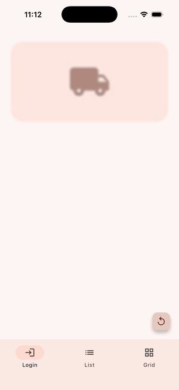
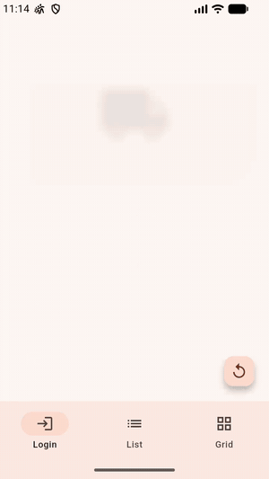

# stagger_kit

[](https://github.com/jcazalELPAKOMICHI/stagger_kit/actions/workflows/ci.yml)
[](https://pub.dev/packages/stagger_kit)

Staggered entrance animations for Flutter, the effect where each element
of a screen appears one after another: logins, onboarding, lists, grids.

| iOS | Android |
| :---: | :---: |
|  |  |

*Login cascade (`StaggerPresets.focusUp`), lazy list (`slideFromRight`) and
diagonal grid (`pop`), all from the [example app](example/lib/main.dart).*

- **One line** for any list of widgets: `[...].stagger()`
- **Composable effects**: fade, move, slide, scale, blur, or your own
- **Lazy lists and grids**: cascade on first frame, no replays while scrolling,
  diagonal waves for grids
- **Group control**: replay, reverse (in opposite order) and reset with a
  `StaggerController`
- **Accessible**: respects the system "reduce motion" setting
- **State-safe**: effects never change the widget tree, so text fields keep
  focus and content while animating
- **Zero dependencies**

## Getting started

```yaml
dependencies:
  stagger_kit: ^0.1.0
```

```dart
import 'package:stagger_kit/stagger_kit.dart';
```

## Usage

### Screens (Column, Row, Wrap, ListView)

```dart
Column(
  children: [
    const Logo(),
    const Text('Welcome back'),
    const EmailField(),
    const PasswordField(),
    LoginButton(onPressed: login),
  ].stagger(),
)
```

Tune it:

```dart
[...].stagger(
  effects: StaggerPresets.focusUp,           // fade + rise + un-blur
  interval: const Duration(milliseconds: 60), // gap between items
  duration: const Duration(milliseconds: 500),
  delay: const Duration(milliseconds: 200),   // before the first item
  order: StaggerOrder.centerOut,
  onComplete: () => debugPrint('done'),
)
```

### A single widget

```dart
const Banner().animateIn(effects: StaggerPresets.pop);
```

### Lazy lists and grids

Wrap the scrollable in a `StaggerScope` and tag each item with its index:

```dart
StaggerScope(
  child: ListView.builder(
    itemCount: orders.length,
    itemBuilder: (context, i) => OrderTile(orders[i]).staggerAt(i),
  ),
)
```

Items visible on the first frame cascade in. Items reached by scrolling
appear settled (set `animateOnScroll: true` to animate them too), and an
item never re-animates when scrolled back into view.

For grids, pass the column count to get a diagonal wave:

```dart
StaggerScope(
  effects: StaggerPresets.pop,
  child: GridView.builder(
    gridDelegate: const SliverGridDelegateWithFixedCrossAxisCount(crossAxisCount: 3),
    itemBuilder: (context, i) => Tile(i).staggerAt(i, columnCount: 3),
  ),
)
```

### Controlling a group

```dart
final controller = StaggerController();

Column(children: fields.stagger(controller: controller, autoPlay: false));

controller.play();    // animate in
controller.reverse(); // animate out, last item first
controller.replay();  // from the start again
controller.reset();   // hide immediately
```

## Effects

| Effect | What it does |
| --- | --- |
| `FadeEffect` | Opacity |
| `MoveEffect` | Translation in logical pixels (same distance for every item) |
| `SlideEffect` | Translation as a fraction of the item's size |
| `ScaleEffect` | Scale around an alignment |
| `BlurEffect` | Gaussian blur, disabled once settled |
| `CustomEffect` | Anything else, from a builder |

Every effect takes an optional `curve` that overrides the item's curve, so
you can, say, fade linearly while scaling with an overshoot.

Presets in `StaggerPresets`: `fadeIn`, `fadeUp` (default), `fadeDown`,
`slideFromLeft`, `slideFromRight`, `scaleIn`, `pop`, `blurIn`, `focusUp`.

## Example

The [example](example/lib/main.dart) app has a login cascade, a lazy list
and a diagonal grid:

```bash
cd example && flutter run
```

## Credits

Inspired by the APIs of
[flutter_animate](https://pub.dev/packages/flutter_animate) (composable
effects and extension methods) and
[flutter_staggered_animations](https://pub.dev/packages/flutter_staggered_animations)
(staggering lazy lists and grids). stagger_kit is an independent
implementation and does not include code from either package.

## License

MIT
